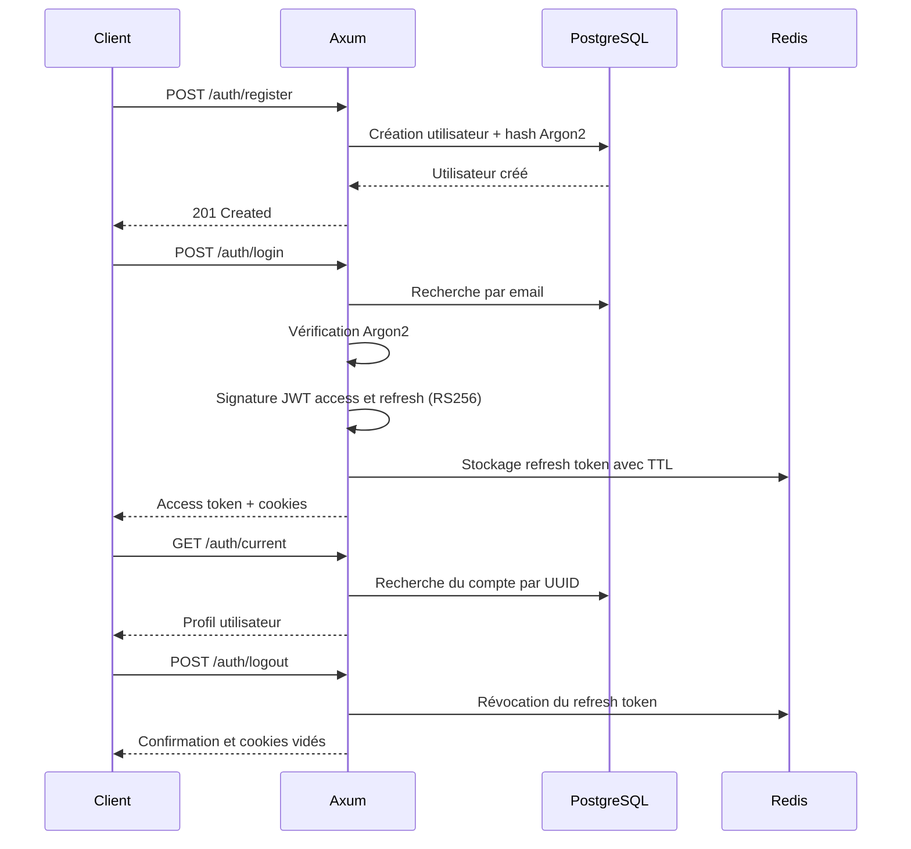

# 🔐 Axum Auth App

    

> API REST d'authentification développée en **Rust** avec **Axum**, **Tokio**, **SQLx**, **PostgreSQL**, **Redis**, **Argon2** et **JWT RS256**. Un projet pratique consacré à l'authentification, à la gestion de sessions et à la conception de services backend asynchrones.

**Auteur : [Sylvain TIASSOU](https://github.com/sylvainTIASSOU)** · [Dépôt GitHub](https://github.com/sylvainTIASSOU/axum-auth-app)

## Sommaire

- [Présentation](#présentation)
- [Fonctionnalités](#fonctionnalités)
- [Stack technique](#stack-technique)
- [Architecture](#architecture)
- [Installation et lancement](#installation-et-lancement)
- [Référence API](#référence-api)
- [Cycle d'authentification](#cycle-dauthentification)
- [Sécurité](#sécurité)
- [Tests et qualité](#tests-et-qualité)
- [Compétences mises en pratique](#compétences-mises-en-pratique)
- [Améliorations possibles](#améliorations-possibles)

## Présentation

**Axum Auth App** est un service d'authentification HTTP conçu pour expérimenter les bonnes pratiques backend en Rust. Il utilise PostgreSQL pour conserver les utilisateurs et Redis pour conserver les informations des refresh tokens, avec des tokens d'accès JWT signés par clé RSA (RS256).

Le code actuellement publié expose l'inscription, la connexion, la consultation du compte courant et la déconnexion. Ce dépôt est un **projet de démonstration et d'apprentissage**, et n'est pas présenté ici comme un service audité ou prêt pour un déploiement de production sans durcissement supplémentaire.

## Fonctionnalités

- **Inscription** d'utilisateurs en base PostgreSQL.
- **Hachage des mots de passe** via Argon2, avec sel aléatoire.
- **Connexion** par email et mot de passe.
- **Génération de deux JWT** (access et refresh) signés avec **RS256**.
- **Enregistrement des refresh tokens** dans Redis, avec durée de vie (TTL).
- **Protection de routes** avec des middlewares d'authentification (`AuthLayer` et `RefreshLayer`).
- **Récupération du profil connecté** depuis PostgreSQL.
- **Déconnexion** déclenchant la suppression d'une entrée de refresh token dans Redis.
- **Traçage des requêtes** avec `tracing` et `tower-http`.
- **Infrastructure locale Docker Compose** pour PostgreSQL et Redis.

> **Périmètre vérifié :** aucune route autonome `/auth/refresh`, ni interface Swagger, n'a été identifiée dans le routeur actuel. Le nom `RefreshLayer` indique une logique de rafraîchissement au niveau middleware ; son comportement précis doit être confirmé avant de documenter un flux HTTP de renouvellement distinct.

## Stack technique

| Domaine | Outil | Rôle |
| --- | --- | --- |
| Langage | Rust, édition 2024 | Backend et sûreté des types |
| HTTP | Axum 0.8 | Routeur et handlers |
| Asynchrone | Tokio | Runtime async |
| Données | PostgreSQL 17 | Stockage durable des utilisateurs |
| Accès SQL | SQLx 0.9 | Pool, requêtes paramétrées, mapping des lignes |
| Sessions | Redis | Stockage des refresh tokens et TTL |
| Mot de passe | Argon2 | Hachage et vérification |
| JWT | jsonwebtoken | Signatures RS256 et validation des claims |
| Données HTTP | Serde / serde_json | Sérialisation et désérialisation JSON |
| Observabilité | tracing, tracing-subscriber, tower-http | Journaux et traces des requêtes |
| Configuration | config / YAML | Configuration applicative |
| Erreurs | thiserror, color-eyre | Gestion et diagnostic des erreurs |
| Environnement | Docker Compose | Services PostgreSQL et Redis locaux |

Versions issues du `Cargo.toml` du dépôt au 20 octobre 2026.

## Architecture

```text
axum-auth-app/
├── Cargo.toml               # Package, bibliothèque et binaire
├── Cargo.lock
├── compose.yaml             # PostgreSQL et Redis
├── config/                  # Configuration de l'application
├── migrations/              # Scripts de migration SQL
└── src/
    ├── bin/main.rs          # Point d'entrée du binaire `auth`
    ├── lib.rs               # Exports des modules
    ├── app.rs               # Démarrage HTTP et montage des routes
    ├── context.rs           # AppContext, PostgreSQL, Redis, JWT
    ├── config/              # Chargement de la configuration
    ├── controllers/
    │   └── auth.rs          # Register, login, current, logout
    ├── middlewares/         # AuthLayer, RefreshLayer, tracing
    ├── models/
    │   ├── mod.rs
    │   ├── users.rs          # DTO, modèle SQLx et Argon2
    │   ├── token.rs          # Claims et détails des JWT
    │   └── error.rs
    └── error/                # Types d'erreurs applicatives
```

Les répertoires `config/`, `middlewares/` et `error/` sont présentés par responsabilité : leur contenu peut évoluer.

### Répartition des responsabilités

1. `app.rs` initialise la configuration, le contexte partagé et le serveur Axum.
2. `controllers/auth.rs` traite les requêtes HTTP et construit les réponses.
3. `models/users.rs` gère les utilisateurs, les requêtes SQL paramétrées et la vérification des mots de passe.
4. `context.rs` centralise le pool PostgreSQL, Redis et les clés JWT.
5. Les middlewares contrôlent l'accès aux routes protégées et contribuent aux traces HTTP.

Le contexte applicatif est partagé via `Arc<AppContext>` ; l'initialisation utilisée par `App::run` est asynchrone (`AppContext::try_from(&config).await`).

## Installation et lancement

### Prérequis

- Rust stable avec Cargo, compatible avec **l'édition 2024**.
- Docker et Docker Compose.
- Une configuration applicative valide et les clés RSA attendues par le projet.
- Facultatif : `sqlx-cli` si vous souhaitez appliquer les migrations avec la CLI SQLx.

### 1. Cloner le projet

```bash
git clone https://github.com/sylvainTIASSOU/axum-auth-app.git
cd axum-auth-app
```

### 2. Configurer l'environnement

Le fichier `compose.yaml` attend ces variables :

```dotenv
POSTGRES_USER=app_user
POSTGRES_PASSWORD=replace-with-a-strong-password
POSTGRES_DATABASE=auth_db
```

Créez localement un fichier `.env` contenant ces valeurs **d'exemple**. Configurez ensuite les paramètres de connexion, JWT et réseau à partir des fichiers du répertoire `config/`. Les noms exacts des clés de configuration doivent être vérifiés dans ce répertoire ; ils ne sont pas inventés ici.

**Ports Docker locaux définis dans `compose.yaml` :**

- PostgreSQL : `localhost:5434` (conteneur : `5432`).
- Redis : `localhost:6377` (conteneur : `6379`).

Ainsi, pour une exécution de l'API sur la machine hôte, les URL de connexion devront viser ces **ports publiés**, et non les ports internes des conteneurs.

> **Sécurité :** le dépôt public contient un fichier `.env`. N'y stockez aucune valeur secrète réelle. En cas de publication passée d'identifiants ou de clés privées, faites une rotation et retirez-les également de l'historique Git si nécessaire.

### 3. Démarrer PostgreSQL et Redis

```bash
docker compose up -d
docker compose ps
```

### 4. Appliquer les migrations

Le dépôt comporte un répertoire `migrations/`. Si ses fichiers suivent les conventions SQLx, vous pouvez utiliser :

```bash
cargo install sqlx-cli --no-default-features --features postgres
# Configurer DATABASE_URL pour pointer vers la base locale
sqlx migrate run
```

Vérifiez les scripts et la configuration réelle avant la première exécution. Cette commande ne configure pas automatiquement les clés JWT.

### 5. Construire et démarrer

```bash
cargo check
cargo run --bin auth
```

L'adresse du serveur est déterminée par `config.server().address()` ; elle n'est donc pas fixée arbitrairement dans cette documentation. Dans les exemples suivants, remplacez `http://localhost:8000` par l'adresse affichée au démarrage.

## Référence API

Les routes ci-dessous ont été vérifiées dans `src/app.rs` et `src/controllers/auth.rs`.

| Méthode | Route | Accès | Description |
| --- | --- | --- | --- |
| `GET` | `/hello` | Public | Message de démonstration |
| `POST` | `/auth/register` | Public | Enregistrement d'un utilisateur |
| `POST` | `/auth/login` | Public | Vérification des identifiants et génération de tokens |
| `GET` | `/auth/current` | Protégé | Retourne `name`, `pid`, `email` |
| `POST` | `/auth/logout` | Protégé | Révocation d'un refresh token et réponse de déconnexion |

Les routes `current` et `logout` utilisent `AuthLayer` et `RefreshLayer`. Selon la configuration de ces middlewares, le comportement peut dépendre des cookies et/ou d'un header d'autorisation.

### `POST /auth/register`

**Corps JSON :**

```json
{
  "name": "Ada Lovelace",
  "email": "ada@example.com",
  "password": "Example-Strong-Password-123!"
}
```

**Réponse attendue en cas de création :** `201 Created`

```json
{"message":"User created succesfully"}
```

L'orthographe de `succesfully` reflète actuellement la réponse codée dans le projet.

**Essai cURL :**

```bash
curl -i -X POST http://localhost:8000/auth/register \
  -H 'Content-Type: application/json' \
  -d '{"name":"Ada Lovelace","email":"ada@example.com","password":"Example-Strong-Password-123!"}'
```

### `POST /auth/login`

**Corps JSON :**

```json
{
  "email": "ada@example.com",
  "password": "Example-Strong-Password-123!"
}
```

Lorsqu'une connexion réussit, le contrôleur renvoie un access token, le nom de l'utilisateur et une date de création, ainsi que des headers `Set-Cookie` pour `access_token` et `refresh_token`.

```json
{
  "access_token": "<JWT_ACCESS_TOKEN>",
  "name": "Ada Lovelace",
  "created_at": "2026-10-20 12:00"
}
```

La date est un exemple de format, pas une valeur réelle.

```bash
curl -i -c cookies.txt -X POST http://localhost:8000/auth/login \
  -H 'Content-Type: application/json' \
  -d '{"email":"ada@example.com","password":"Example-Strong-Password-123!"}'
```

### `GET /auth/current`

Renvoie le profil de l'utilisateur identifié par le token :

```json
{
  "name": "Ada Lovelace",
  "pid": "00000000-0000-4000-8000-000000000000",
  "email": "ada@example.com"
}
```

La valeur UUID ci-dessus est fictive.

```bash
curl -i -b cookies.txt http://localhost:8000/auth/current
```

### `POST /auth/logout`

Le handler demande la révocation du token associé à l'identifiant `token_id` et répond :

```json
{"message":"Logout success"}
```

```bash
curl -i -b cookies.txt -X POST http://localhost:8000/auth/logout
```

> **Point à vérifier :** les cookies sont actuellement réémis avec une valeur vide, mais une durée de vie positive dans le handler `logout`. Pour une suppression fiable côté navigateur, définir `Max-Age=0` ou une date d'expiration passée.

## Cycle d'authentification



## Sécurité

### Mécanismes présents dans le code

- Argon2 pour calculer et vérifier les hachages des mots de passe.
- Génération de JWT **RS256** avec identifiants UUID, `iat`, `nbf` et `exp`.
- Clés de signature et de vérification distinctes pour la cryptographie asymétrique.
- Refresh tokens suivis dans Redis, avec TTL et suppression explicite.
- `HttpOnly` activé sur le cookie `refresh_token`, mais désactivé sur le cookie `access_token`.
- `SameSite=Lax` pour les cookies créés dans le login.
- Requêtes SQL avec paramètres liés (`.bind(...)`) plutôt que concaténation de chaînes.

### Points à renforcer avant production

1. **Secrets :** ne pas versionner `.env` ni les clés privées ; faire une rotation des secrets déjà exposés.
2. **Cookies :** effacer les cookies avec `Max-Age=0` au logout ; activer `Secure` sous HTTPS ; réévaluer le choix de rendre le cookie d'accès lisible par JavaScript.
3. **Protection CSRF/XSS :** définir une stratégie de sécurité cohérente avec le mode d'authentification choisi (cookies ou Bearer).
4. **Révocation :** vérifier que le token révoqué est bien le refresh token associé à la session et que les middlewares valident son état Redis.
5. **Attaques par force brute :** ajouter un rate limiting et une stratégie d'audit des connexions.
6. **Entrées :** valider explicitement le format email, la taille des champs et la robustesse du mot de passe, avant insertion.
7. **Expiration Redis :** vérifier que le TTL ne peut pas devenir négatif ou être converti en durée énorme.
8. **Erreurs :** s'assurer que les réponses publiques n'exposent pas d'informations internes ou de détails SQL.
9. **Code mort :** supprimer l'ancien `TryFrom<&Config>` bloquant de `AppContext`, devenu inutile au profit de l'initialisation asynchrone.
10. **Vérifications automatisées :** effectuer des tests de sécurité et une revue de configuration avant toute mise en production.

## Tests et qualité

```bash
cargo fmt --all -- --check
cargo check
cargo clippy --all-targets -- -D warnings
cargo test
```

Ces commandes sont proposées pour vérifier le projet ; **leur réussite n'a pas été confirmée lors de cette analyse distante**. Les tests d'intégration devraient couvrir la création de comptes, les mots de passe incorrects, les JWT expirés, la révocation, les doublons d'emails et les erreurs PostgreSQL/Redis.

## Compétences mises en pratique

Ce projet permet de montrer concrètement les compétences suivantes dans un **portfolio Rust backend** :

| Compétence | Réalisation observable |
| --- | --- |
| **Rust backend** | Structures, modules, `Result`, traitement d'erreurs, `Arc`, `Cow<'a, str>` |
| **Axum & API REST** | Handlers asynchrones, `Router`, `State`, `Extension`, `Json`, middlewares |
| **Tokio / async** | Initialisation des connexions, appels SQL et Redis asynchrones |
| **PostgreSQL / SQLx** | Pool de connexions, `query_as`, `FromRow`, requêtes SQL paramétrées |
| **Sécurité applicative** | Argon2, JWT RS256, cookies, contrôles d'accès et révocation |
| **Redis** | Stockage de tokens, TTL et suppression de session |
| **Architecture backend** | Séparation des contrôleurs, modèles, contexte, configuration et middlewares |
| **Observabilité** | Tracing structuré des échanges HTTP |
| **DevOps local** | Compose, bases de données en conteneurs et configuration d'environnement |

**Présentation courte pour un CV ou LinkedIn :**

> Développement d'une API d'authentification en Rust/Axum intégrant inscription et connexion, mots de passe hachés avec Argon2, tokens JWT RS256, persistance PostgreSQL/SQLx et gestion des refresh tokens dans Redis. Conception de middlewares d'authentification, partage d'état asynchrone avec Tokio et traçage HTTP.

## Améliorations possibles

Ces évolutions ne sont **pas présentées comme déjà implémentées** :

- Endpoint dédié de renouvellement `/auth/refresh` si nécessaire.
- Confirmation d'email, mot de passe oublié, déconnexion multi-appareils.
- Swagger UI et spécification OpenAPI générée via Utoipa.
- Validation d'entrée, limitation de débit, tests d'intégration complets.
- CI GitHub Actions (format, lint, tests, audit de sécurité).
- Documentation des schémas de migration et exemples de configuration nettoyés.

## Ressources

- [Documentation Axum](https://docs.rs/axum/latest/axum/)
- [Documentation Tokio](https://tokio.rs/)
- [Documentation SQLx](https://docs.rs/sqlx/latest/sqlx/)
- [Documentation Argon2](https://docs.rs/argon2/latest/argon2/)
- [Documentation Redis Rust](https://docs.rs/redis/latest/redis/)
- [The Rust Programming Language](https://doc.rust-lang.org/book/)

---

**Auteur : Sylvain TIASSOU** — [GitHub](https://github.com/sylvainTIASSOU)

_Documentation établie à partir du code public consulté le 20 octobre 2026. Les exemples utilisent des identifiants fictifs et ne remplacent pas les tests fonctionnels sur une instance locale._
